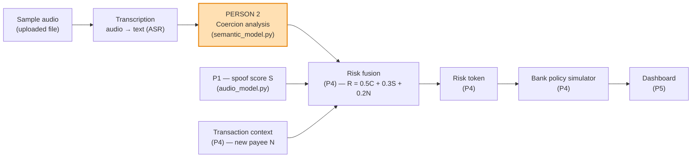
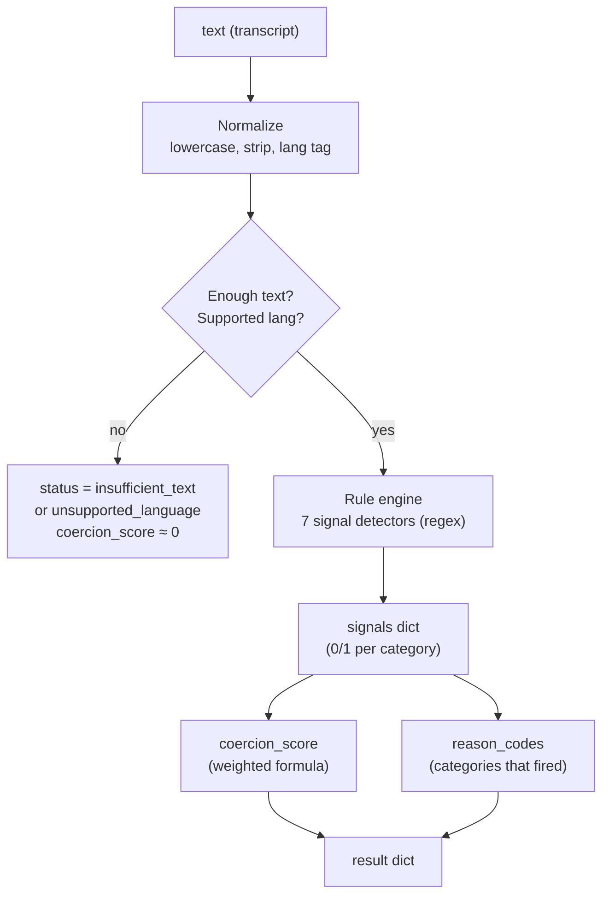

# Person 2 — Speech & Coercion Detection · Architecture

> **Who this is for:** the whole VerifVoice team (Persons 1–6), especially **Person 3 (backend/API)** and
> **Person 4 (risk fusion)**, who integrate against this module.
> **Owner:** Person 2. **Deliverable:** `semantic_model.py`.
> **Read this first:** the one-paragraph summary below; then the Interface Contract (§3) if you're P3/P4.

---

## 1. TL;DR

Person 2 turns **call audio → text → a coercion signal**. The module detects whether a caller is using
**urgency, authority, secrecy, verification-refusal, threats, or direct financial instructions** to pressure
someone into a payment. It returns a **coercion score (0–1)** plus **human-readable reason codes** — and it is
the **highest-weight input** into the team's risk score:

```
R = 0.5·C + 0.3·S + 0.2·N
        ▲        ▲        ▲
        │        │        └─ N = new beneficiary (P4)
        │        └─ S = spoof/audio-authenticity score (P1)
        └─ C = coercion score (PERSON 2 — this module)
```

**Design principle:** start with a **transparent rule engine** (deterministic, explainable, works even if ASR is
flaky). Add a compact ML classifier only if time remains. A synthetic voice or a scary story is **never enough on
its own** — coercion is detected from *language patterns*, and everything is traceable to the exact words that
triggered it.

---

## 2. Where this fits in the system



Person 2 owns the two leftmost boxes that touch speech: **transcription** (audio → text) and **coercion
analysis** (text → score + reason codes). The output is consumed by Person 4's fusion engine.

---

## 3. Interface contract (freeze this with P3 & P4)

`semantic_model.py` exposes **three functions**. P3's FastAPI backend calls them; P4 consumes the result.

> **✅ DECIDED (locked):** P3 calls the **dispatcher** `analyze(source, input_type=...)` and never calls
> `transcribe()`/`analyze_transcript()` directly. This means P2 supports **both** audio (with ASR) and text
> (scripted transcripts) behind one entry point, so the rule engine is never blocked if ASR is slow or fails on
> s390x. The scripted-transcript path is a **first-class supported path**, not a hack.

```python
# ---- 1. transcription (audio -> text) ----
def transcribe(audio_path: str, lang: str = "en") -> str:
    """Return the transcript text. Return "" if transcription fails/unsupported."""

# ---- 2. coercion analysis (text -> signal) — the CORE ----
def analyze_transcript(text: str, lang: str = "en") -> dict:
    """Analyze transcript text and return the coercion signal (schema below)."""

# ---- 3. convenience dispatcher ----
def analyze(source: str, input_type: str = "text", lang: str = "en") -> dict:
    """If input_type == 'audio', transcribe first, then analyze. Else treat source as text."""
```

### 3.1 `analyze_transcript()` — the result schema (the contract everyone builds against)

```json
{
  "coercion_score": 0.91,
  "reason_codes": ["COERCIVE_URGENCY", "FINANCIAL_INSTRUCTION", "VERIFICATION_REFUSAL"],
  "signals": {
    "urgency": 1.0,
    "authority_claim": 1.0,
    "secrecy_pressure": 0.0,
    "verification_refusal": 1.0,
    "financial_instruction": 1.0,
    "threat": 0.0,
    "emergency_narrative": 1.0
  },
  "status": "analyzed",
  "lang": "en"
}
```

| Field | Type | Meaning | Notes for P4 |
|---|---|---|---|
| `coercion_score` | float 0–1 | The **C** in `R = 0.5C + 0.3S + 0.2N` | Feed directly into fusion |
| `reason_codes` | list[str] | Which cues fired (see vocabulary §3.2) | Merge into the risk token's `reason_codes` |
| `signals` | dict[str, float] | Per-category 0–1 scores | Powers the dashboard "why" breakdown |
| `status` | str | `analyzed` \| `insufficient_text` \| `unsupported_language` | If not `analyzed`, treat C as low/uncertain |
| `lang` | str | Declared language | For evidence + coverage tracking |

### 3.2 Reason-code vocabulary (shared contract — P4 merges these into the token)

| Reason code | Fires when the caller… | Example trigger words |
|---|---|---|
| `COERCIVE_URGENCY` | Demands immediate action | "act now", "urgent", "immediately", "within 5 minutes", "hurry" |
| `AUTHORITY_CLAIM` | Claims to be an official | "police", "bank", "RBI", "hospital", "officer", "government", "CBI" |
| `SECRECY_PRESSURE` | Demands secrecy / isolation | "don't tell anyone", "keep this secret", "don't hang up" |
| `VERIFICATION_REFUSAL` | Discourages checking | "don't verify", "trust me", "no need to check", "don't call back" |
| `FINANCIAL_INSTRUCTION` | Directs a money action | "transfer", "UPI", "OTP", "PIN", "pay", "QR code", "send money" |
| `THREAT` | Uses fear/consequences | "arrest", "account blocked", "legal action", "go to jail", "fine" |
| `EMERGENCY_NARRATIVE` | Tells a crisis story | "accident", "hospital", "injured", "kidnapped", "surgery" |

> **Important nuance for P4:** `EMERGENCY_NARRATIVE` is **context, not coercion by itself**. A genuine emergency
> ("Dad had an accident, please come") fires it but should NOT block a payment. It is reported for transparency and
> becomes suspicious only in combination with `FINANCIAL_INSTRUCTION`.

### 3.3 Scoring formula (transparent + configurable)

```python
coercion_score = clamp01(
    0.25 * urgency
  + 0.20 * financial_instruction
  + 0.20 * threat
  + 0.15 * verification_refusal
  + 0.10 * authority_claim
  + 0.10 * secrecy_pressure
)
# emergency_narrative is deliberately EXCLUDED (context, not coercion)
```

- Weights live in a config file/dict so the team can tune them live.
- Each `signals` value is a **presence-capped** 0/1 score (1 hit = 1.0; more hits saturate). This keeps the model
  *explainable* and *auditable*.
- This is a **demo heuristic**, not a calibrated probability. We state that in the README and limitations.

---

## 4. Internal architecture



### 4.1 Component breakdown

| # | Component | What it does | Dependency | Effort |
|---|---|---|---|---|
| 1 | **Transcription** | audio → text via faster-whisper; falls back to scripted transcripts | faster-whisper (installed) | low (optional) |
| 2 | **Normalizer** | lowercase, strip, detect language, length gate | stdlib | trivial |
| 3 | **Rule engine** | 7 regex detectors → per-category 0/1 signals | stdlib `re` | core (most of the work) |
| 4 | **Scorer** | weighted combination → `coercion_score` + `reason_codes` | stdlib | trivial |
| 5 | **Classifier (stretch)** | TF-IDF + logistic regression to boost rule recall | scikit-learn (installed) | optional |

### 4.2 Data flow for one call

1. **Audio in** (uploaded sample, `.wav`/`.mp3`) → `transcribe()` → text. *If ASR fails or is skipped, the demo
   passes a scripted transcript directly — this is a first-class supported path, not a hack.*
2. **Text** → `analyze_transcript()` → normalize → length/language gate.
3. **Rule engine** scans for the 7 signal categories; each category scores 0 (absent) or 1 (present).
4. **Scorer** computes the weighted `coercion_score` and emits the `reason_codes` for categories that fired.
5. **Result** is returned to P3 → forwarded to P4's fusion engine. **The full transcript is not persisted** and is
   not included in the risk token (only in the transient in-memory response for the dashboard).

---

## 5. Safety & abstention rules (non-negotiable)

These are the *behaviours* this module must obey — judges and teammates will check them.

1. **Too little text** (e.g. < 5 words) → `status: "insufficient_text"`, score ≈ 0. Weak signal, not fraud.
2. **Unsupported language** → `status: "unsupported_language"`, score ≈ 0, and the system may *warn/abstain* but
   must **never auto-restrict** a payment.
3. **Emergency narrative alone** never raises the score (a real emergency is not coercion).
4. **Synthetic/ASR errors** must not manufacture confidence — if the transcript looks garbled, lower confidence.
5. **No transcript on disk.** Text is processed in memory and released. P4's token carries only reason codes.

---

## 6. Dependencies & where it runs

| Layer | Where it runs | Why it matters |
|---|---|---|
| Rule engine + scorer (core) | **Anywhere, incl. LinuxONE s390x** — pure Python stdlib | This is the "real AI logic on LinuxONE" evidence; trivially portable |
| Transcription (ASR) | Laptop first; LinuxONE **if** faster-whisper/ctranslate2 installs on s390x (P3 verifies) | Fallback = scripted transcripts, so P2 is never blocked |
| Classifier (stretch) | scikit-learn — portable, runs on s390x | Optional recall boost |

**Installed & ready** (see `ENVIRONMENT.md`): `faster-whisper`, `scikit-learn`, `numpy`. No `torch` required for
this module's core (rules are stdlib-only).

---

## 7. Risks & fallbacks

| Risk | Impact | Fallback |
|---|---|---|
| ASR slow / fails on s390x | Blocks audio→text | Use **scripted transcripts** (demo passes pre-written text) |
| Rules miss paraphrased coercion | Lower recall | Compact TF-IDF+logreg classifier (stretch); fusion with P1's signal covers some gaps |
| **Negated mention (false-positive code)** | A legit line like *"we will NEVER ask for your OTP/PIN"* fires `FINANCIAL_INSTRUCTION` | Score contribution is only +0.20 (LOW, never blocks alone); document as a known rules-vs-LLM tradeoff — see Phase 5 |
| Unsupported language (e.g. Tamil) | False negative | `unsupported_language` → abstain/warn, never block |
| Over-fitting keyword lists | False positives | Keep lists high-precision; presence-capped scoring; tune weights with P4 |
| Garbled transcript (noisy audio) | Wrong signals | Length/quality gate → lower confidence |

---

## 8. Acceptance criteria for Person 2 (what "done" looks like)

- [ ] `analyze_transcript()` returns the exact schema in §3.1 for any input.
- [ ] All 7 reason codes are traceable to the matched words (for the dashboard "why").
- [ ] The 4 core test scenarios (§9) produce the expected scores/codes.
- [ ] Insufficient-text and unsupported-language inputs abstain correctly.
- [ ] No transcript is written to disk.
- [ ] `coercion_score` feeds P4's fusion formula unchanged.
- [ ] Keyword lists + weights are in a config file, not hard-coded in logic.

---

## 9. Core test scenarios (Person 2's part of the shared suite)

| # | Transcript (abridged) | Expected `coercion_score` | Expected reason codes |
|---|---|---|---|
| A | "Hi, how's the family? Just catching up." | low (< 0.3) | (none) |
| B | "Your son is in hospital. Transfer ₹50,000 NOW. Don't tell anyone. Don't verify." | high (≥ 0.7) | `COERCIVE_URGENCY`, `FINANCIAL_INSTRUCTION`, `SECRECY_PRESSURE`, `VERIFICATION_REFUSAL`, `EMERGENCY_NARRATIVE` |
| C | "This is your pharmacy; please pay your usual bill." (synthetic voice, benign) | low (< 0.3) | (none or `FINANCIAL_INSTRUCTION` only) |
| D | "Dad had an accident, please come to the hospital." | moderate (< 0.55) | `EMERGENCY_NARRATIVE` **only** → no payment block |

> Person 6 records these numbers into the results table. P2 supplies the scores/codes and per-rule latency.

---

## 10. Files Person 2 owns

```
semantic_model.py        # transcribe() + analyze_transcript() + analyze()  (created during the event)
semantic_config.py       # keyword lists + weights + thresholds (tunable)
semantic_tests.py        # the 4 scenarios + unit checks (created during the event)
data/transcripts/*.txt   # labelled examples (coercive vs benign) — no real victim data
```
