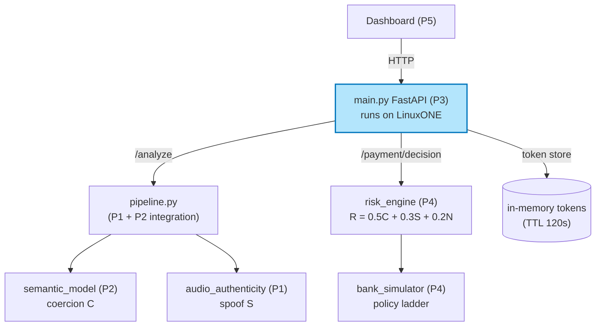
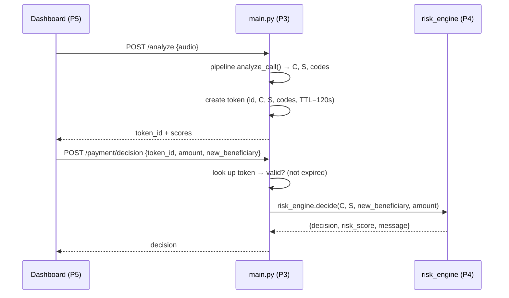

# Person 3 — Backend & LinuxONE Deployment · Architecture

> **Owner:** (was Person 3, now covered by the team) · **Deliverable:** `main.py` running on LinuxONE.
> **Who this is for:** the whole team — especially Person 4 (risk fusion) and Person 5 (frontend), who
> integrate against this API. Read §3 (contract) first if you're P4/P5.

---

## 1. Role summary

Person 3 owns the **hub** everything plugs into:

1. The **FastAPI backend** (`main.py`) with the 4 endpoints.
2. The **API contract** (frozen JSON shapes — everyone builds against these).
3. **Integration** — wires Person 1 (`audio_authenticity`), Person 2 (`semantic_model`), and Person 4
   (`risk_engine` + `bank_simulator`) into one running service.
4. The **in-memory risk-token service** (TTL + cleanup).
5. **LinuxONE deployment + evidence** (the thing judges actually check).
6. **Privacy/security controls** (no audio persistence, secrets, rate limits).

---

## 2. Where this fits



`main.py` is the only process P5 talks to. It orchestrates the other modules and owns the token store.

---

## 3. API contract (freeze this — P4 & P5 build against it)

### `GET /health`
```json
{
  "status": "ok",
  "semantic_rules": "ready",
  "transcription": "ready",
  "audio_authenticity": "model_unavailable",
  "risk_engine": "ready"
}
```
Each value is "ready" / "unavailable". Never 500 — a missing model is a status, not a crash.

### `POST /analyze`
Request body:
```json
{ "source": "C:/path/call.wav", "input_type": "audio", "lang": "en" }
```
(`source` = transcript text when `input_type="text"`, else a file path. P5 can also send a file upload — see §6.)

Response:
```json
{
  "request_id": "demo-001",
  "token_id": "8f2a…",             // store this; pass to /payment/decision
  "token_ttl_seconds": 120,
  "audio_status": "analyzed",
  "coercion_score": 0.85,
  "reason_codes": ["COERCIVE_URGENCY", "FINANCIAL_INSTRUCTION"],
  "signals": { "urgency": 1.0, "...": 0.0 },
  "spoof_score": null,
  "spoof_status": "model_unavailable",
  "spoof_classification": "uncertain",
  "quality_score": 1.0,
  "model_name": "unavailable"
}
```

### `POST /payment/decision`
Request body:
```json
{ "token_id": "8f2a…", "amount": 50000, "new_beneficiary": true }
```

Response:
```json
{
  "decision": "verify",
  "risk_score": 0.55,
  "reason_codes": ["COERCIVE_URGENCY", "FINANCIAL_INSTRUCTION", "NEW_PAYEE"],
  "message": "This call shows signs of urgent payment pressure. The recipient is new. End the call and verify using a number you already trust."
}
```
`decision` ∈ `observe | warn | verify | pause`.

### `GET /metrics`
```json
{ "analyze_requests": 12, "payment_requests": 4, "last_analyze_ms": 8.1, "last_payment_ms": 3.2, "uptime_seconds": 1234 }
```

---

## 4. Token flow (the key connection between the two POSTs)



**Rules:**
- Token = random opaque id + stored scores + `expires_at`. **Never store transcript/audio in the token.**
- `/payment/decision` on an expired/missing token → `HTTP 400` with `"token expired or unknown"`.
- Expired tokens are purged lazily on each new `/analyze`.

---

## 5. Module dependencies (what P3 imports)

| Module | Owner | P3 calls it for | Status |
|---|---|---|---|
| `pipeline.analyze_call()` | P3 (integration) | coercion + spoof in one call | ✅ done |
| `semantic_model` | P2 | coercion (via pipeline) | ✅ done |
| `audio_authenticity` | P1 | spoof (via pipeline) | ✅ done (model_unavailable by default) |
| `risk_engine` | P4 | fusion `R` + decision | ⏳ not built yet |
| `bank_simulator` | P4 | policy ladder + message | ⏳ not built yet |

**Fallback (important):** because P4 isn't built yet, P3 ships a **minimal inline risk engine** in `main.py`
(the exact `R = 0.5·C + 0.3·S + 0.2·N` + ladder below) so the demo works end-to-end **today**. When P4 delivers
`risk_engine.py`, P3 swaps the inline logic for `from risk_engine import decide` — a 5-line change.

---

## 6. Risk fusion + policy ladder (reference — P4 owns the real one)

```
R = 0.5 * coercion_score  +  0.3 * spoof_score  +  0.2 * new_beneficiary(0|1)
```
- If `spoof_score` is `None` (model unavailable), **treat S as 0 and renormalize onto C** — do NOT fabricate a
  number. (Concretely: use `R = 0.8·C + 0.2·N` in that case, and log the degraded path.)

| R range | decision | action |
|---|---|---|
| < 0.30 | `observe` | no friction |
| 0.30–0.55 | `warn` | in-call caution: "verify using a known number" |
| 0.55–0.75 | `verify` | prompt to end call + out-of-band verification |
| ≥ 0.75 | `pause` | short reversible hold (simulated) |

**Never** return `pause` from the spoof/coercion signal alone without `new_beneficiary` or high `C`+`S`
combined — a synthetic voice or a scary story alone must not block.

---

## 7. Privacy & security controls (P3 owns these)

1. **No audio persistence** — audio is decoded in memory; never written to disk. (P1's `load_audio` and P2's
   `transcribe` both already satisfy this — P3 just must not *add* any disk writes.)
2. **Token TTL + cleanup** — tokens expire (120 s) and are purged; token carries scores + reason codes only.
3. **Secrets via env** — any key/credential (e.g. the SSH key for LinuxONE) lives outside the repo; `.env` +
   `*.pem` are gitignored.
4. **Rate limiting** (optional) — a simple per-IP counter on `/analyze` is enough for the demo.
5. **CORS** — enable for the Streamlit/HTML frontend origin.

---

## 8. LinuxONE deployment (the differentiator)

**Runs on LinuxONE (must):** `main.py`, `pipeline.py`, `semantic_model` (rule engine), `risk_engine`, the token
service. All pure-Python → portable to s390x.

**Runs on the laptop (allowed, label it):** ASR (`faster-whisper` + `librosa` + `ctranslate2`) — these need
s390x wheels that may not exist; the **text path is the guaranteed LinuxONE path**, and `audio_authenticity`
is stdlib-only so it works anywhere.

**Evidence checklist (screenshots the judges want):**
```bash
uname -m                          # → s390x
python3 --version
nohup uvicorn main:app --host 0.0.0.0 --port 8000 &   # running service
curl http://localhost:8000/health                      # live response
curl -X POST http://localhost:8000/analyze -H 'Content-Type: application/json' \
     -d '{"source":"Transfer 50000 now, don\u0027t tell anyone","input_type":"text"}'   # real inference on s390x
# latency numbers, and proof no .wav file was written
```

---

## 9. Risks & fallbacks

| Risk | Impact | Fallback |
|---|---|---|
| No s390x wheels for ASR deps | audio→text fails on LinuxONE | run ASR on laptop; text path on LinuxONE; label the boundary |
| P4's risk_engine not ready | /payment/decision dead | P3 ships the inline fallback (§5) — works end-to-end today |
| Spoof model unavailable | `spoof_score=null` | renormalize fusion onto C (never fake a score) |
| Token store lost on restart | demo breaks after restart | acceptable (in-memory); recreate tokens per run |
| Frontend can't reach backend | CORS/origin issue | enable CORS; run uvicorn on `0.0.0.0` |

---

## 10. Acceptance criteria (what "done" looks like)

- [ ] `main.py` serves all 4 endpoints with the exact §3 shapes.
- [ ] `/analyze` (text **and** audio) returns coercion + spoof + a `token_id`.
- [ ] `/payment/decision` returns a ladder decision for a valid token, and 400 for an expired one.
- [ ] Golden path: audio → analyze → token → payment → decision, 3× stable.
- [ ] `/health` reports each module's real status (no fake "ready").
- [ ] Runs on LinuxONE with `uname -m` evidence + a live `/analyze` (text) + latency numbers.
- [ ] No `.wav`/transcript written anywhere in the backend path.

---

## 11. Files Person 3 owns

```
main.py                 # FastAPI backend (rename from example_api.py)
pipeline.py             # P1+P2 integration (already built — P3 owns/extends it)
risk_engine.py          # P4's fusion (P3 ships an inline fallback until P4 delivers)
bank_simulator.py       # P4's policy ladder (same fallback situation)
token_store.py          # in-memory token service (P3)
.env.example            # documents which env vars are needed (secrets stay out)
```
